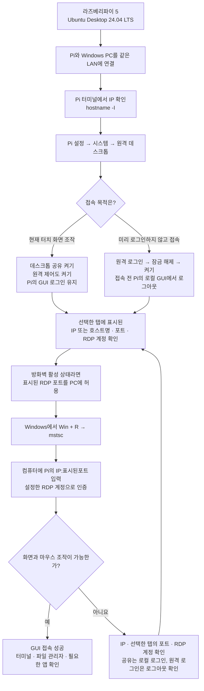
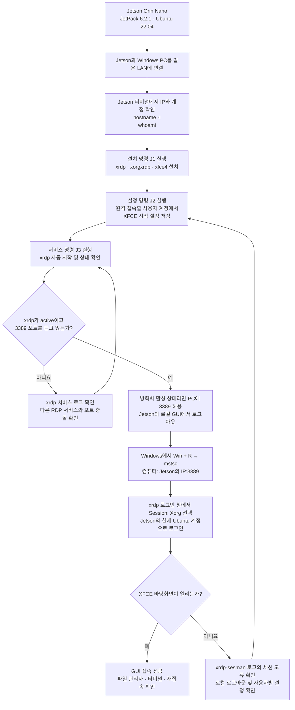

# 라즈베리파이·젯슨 GUI 원격 접속

> 최신 실기 기록: [2026-11-05 트러블슈팅](capstone_code/docs/troubleshooting_history_20261105.md). 아래 절차와 날짜별 성공·실패는 당시 기록이며, 현재 상태는 최신 문서의 확인 범위를 먼저 읽는다.

<!-- project-status:2026-10-12:start -->
> 갱신: 2026-10-12 · [진행 현황·확인 범위](capstone_code/docs/progress_2026-10-12.md)
> Ubuntu SSH·APT 잠금·GUI 없는 실행 조건을 반영했다. 절차 안내와 장치 접속/실행 성공 기록을 구분한다.
<!-- project-status:2026-10-12:end -->

우리의 기본 구성은 Raspberry Pi 5의 **Ubuntu Desktop 24.04 LTS ARM64**, Jetson Orin Nano의 **JetPack 6.2.1 / Ubuntu 22.04 기반 / ROS 2 Humble**이다.

두 장치 모두 Windows의 **원격 데스크톱 연결(mstsc)**로 접속한다. 처음에는 PC와 장치를 같은 공유기의 LAN에 연결한다. PC가 유선이고 장치가 Wi-Fi여도 서로 통신할 수 있으면 된다. 게스트 Wi-Fi의 장치 격리는 해제하거나 일반 LAN을 사용한다.

이 문서는 설정 절차와 날짜별 사용자 확인 기록을 함께 담는다. 아래 Jetson의 접속 성공 기록은 장시간 안정성·재부팅 검증을 대신하지 않는다.

## 0. 원격 명령 입력과 APT 설치 대기

명령 입력은 [Ubuntu SSH](capstone_code/docs/remote_access.md)를 먼저 구성한다.
이 대화의 `ssh yu@192.168.0.173`은 Connection refused였고,
OpenSSH 설치 중 사진에서 unattended-upgrade의 APT 잠금을 확인했다.
후속 설치 로그와 해당 SSH 재접속 결과는 아직 없다.
RealVNC 체험판 만료는 OpenSSH나 Ubuntu RDP 설정과 별개다.
PC 유선 LAN/Pi Wi-Fi는 같은 공유기에서 접근 가능하면 사용할 수 있다.

## 1. 라즈베리파이 — Ubuntu 24.04 내장 RDP

터치 모니터에 실행 중인 `ui.py`를 그대로 확인하려면 **데스크톱 공유**를 선택한다. 장치에서 미리 로그인하지 않고 원격 GUI를 사용하려면 **원격 로그인**을 선택한다. 원격 로그인은 실행 중인 로컬 GUI 세션을 종료할 수 있으므로 현재 터치 화면을 점검할 때는 데스크톱 공유를 사용한다.



Pi 터미널에서 실행:

```bash
hostname -I
sudo ufw status
```

IP가 여러 개면 Windows PC에서 접근 가능한 Wi-Fi 또는 유선 LAN 주소를 고른다. `192.168.10.2`는 Pi–Jetson 직결용 계획 주소이므로 Windows PC에서 접근 가능한지 먼저 확인한다.

**설정 → 시스템 → 원격 데스크톱**에서 필요한 탭을 켜고 해당 탭의 접속 정보와 사용자명·비밀번호를 확인한다. RDP 접속용 계정은 일반 Ubuntu 로그인 계정과 다를 수 있다. 비밀번호는 장치에서 설정하고 보관하며 문서나 채팅에 적지 않는다.

기본적으로 원격 로그인은 3389이다. 데스크톱 공유만 켰을 때도 보통 3389이며, 두 기능을 동시에 켜면 데스크톱 공유가 3390으로 바뀐다. **항상 해당 탭에 실제 표시된 포트를 사용한다.**

UFW가 `active`일 때만 다음 규칙을 추가한다. `WINDOWS_PC_IP`를 Windows PC의 실제 LAN IPv4 주소로 바꾸고, 포트도 해당 탭에 표시된 값으로 바꾼다. Windows PC 주소는 Windows 터미널의 `ipconfig`에서 확인한다.

```bash
sudo ufw allow from WINDOWS_PC_IP to any port 3389 proto tcp
```

Windows에서 **Win + R → mstsc → Enter** 후 컴퓨터 칸에 `PI_IP:PORT`를 실제 주소와 포트로 바꿔 입력한다. 원격 로그인에서 Ubuntu 로그인 화면이 추가로 나타나면 이때는 실제 Ubuntu 사용자 계정으로 로그인한다.

처음 나타나는 인증서 안내에서는 연결 대상 주소를 확인하고 진행한다. 연결 후 파일 관리자 열기, 마우스 조작, 터미널 입력을 확인한다. 터치 화면 점검이라면 데스크톱 공유에서 `ui.py`가 같은 화면에 보이는지도 확인한다.

근거: [Ubuntu 24.04 원격 데스크톱 공식 안내](https://ubuntu.com/desktop/docs/en/24.04/how-to/share-your-desktop-remotely/).

## 2. 젯슨 — xrdp + XFCE

JetPack 6.2.1의 Ubuntu 22.04에는 **xrdp와 원격용 XFCE 데스크톱**을 설치한다. Windows에서는 Pi와 같은 `mstsc`를 사용한다.

**이 방식은 별도의 원격 데스크톱을 연다.** Jetson 모니터에 이미 열려 있는 GNOME 화면·창을 그대로 공유하지 않는다. 파일 관리자·편집기·터미널을 GUI로 사용하기 위한 구성이다. 기존 모니터 화면 자체를 공유하려면 VNC 등 화면 공유 방식이 필요하다. RViz·OpenGL 등 GPU를 사용하는 앱은 원격 세션에서도 정상 표시되는지 따로 확인한다.



아래 명령은 **Jetson 터미널**에서 실행한다. 처음에는 연결된 모니터의 터미널을 사용하고, SSH가 이미 된다면 SSH로 설정해도 된다.

**J1 — 설치**

```bash
hostname -I
whoami
sudo apt update
sudo apt install -y xrdp xorgxrdp xfce4
```

패키지를 찾지 못하면 Universe 저장소 활성 여부를 확인한다. 저장소가 비활성인 경우:

```bash
sudo add-apt-repository universe
sudo apt update
sudo apt install -y xrdp xorgxrdp xfce4
```

설치 중 디스플레이 매니저 선택이 나오면 기존 `gdm3`를 유지한다.

**J2 — 원격용 XFCE 설정**

원격 접속할 **일반 사용자 계정**에서 실행한다. 아래 파일 저장 명령에는 `sudo`를 붙이지 않는다. 기존 `.xsession`이 있으면 먼저 백업한다.

```bash
if [ -f ~/.xsession ]; then
    cp -an ~/.xsession ~/.xsession.before-xrdp
fi
printf '%s\n' 'exec startxfce4' > ~/.xsession
sudo usermod -aG ssl-cert xrdp
```

`.xsession`은 해당 사용자의 X 세션 시작 설정이므로 기존 설정이 있던 경우 백업을 보관한다. 이 절차에서 Jetson의 GPU 드라이버나 전역 Xorg 설정을 변경하지 않는다.

**J3 — 서비스와 방화벽 확인**

```bash
sudo systemctl enable --now xrdp
sudo systemctl restart xrdp
systemctl status xrdp --no-pager
sudo ss -ltnp 'sport = :3389'
sudo ufw status
```

서비스는 `active (running)`, 포트 확인은 3389의 `LISTEN`이 보여야 한다. UFW가 `active`라면 `WINDOWS_PC_IP`를 PC의 실제 LAN 주소로 바꿔 실행한다.

```bash
sudo ufw allow from WINDOWS_PC_IP to any port 3389 proto tcp
```

Jetson의 로컬 GUI에서 **로그아웃**한다. 처음 연결을 확인할 때 같은 사용자로 로컬 GUI와 원격 GUI에 동시에 로그인하지 않는다. SSH 연결 자체는 유지해도 된다.

Windows에서 **Win + R → mstsc → Enter**, 컴퓨터에 `JETSON_IP:3389`를 실제 주소로 바꿔 입력한다. xrdp 로그인 창에서는 **Session: Xorg**, 사용자명·비밀번호는 Jetson의 실제 Ubuntu 계정을 사용한다.

근거: [xrdp 공식 프로젝트](https://github.com/neutrinolabs/xrdp), [Ubuntu 22.04 xrdp 패키지와 ARM64 지원](https://packages.ubuntu.com/jammy/xrdp), [사용자별 X 세션 시작 설정](https://manpages.ubuntu.com/manpages/jammy/man5/Xsession.5.html).

## 3. 연결이 안 될 때

Windows PowerShell에서 `DEVICE_IP`와 포트를 실제 대상 값으로 바꿔 실행한다.

```powershell
Test-NetConnection -ComputerName DEVICE_IP -Port 3389
```

`TcpTestSucceeded: False`면 IP·접속망·공유기 장치 격리·서버 실행·포트·방화벽부터 확인한다. `True`인데 화면이 안 열리면 계정 인증과 GUI 세션을 확인한다.

Jetson 서비스나 화면 오류는 다음 로그로 확인한다.

```bash
sudo journalctl -u xrdp -u xrdp-sesman -b --no-pager -n 80
tail -n 80 ~/.xsession-errors
ls -la ~/.xorgxrdp*.log
```

`.xsession-errors`나 Xorg 로그가 아직 생성되지 않았으면 없는 파일이라는 메시지가 나올 수 있다. 로그인 직후 끊기거나 검은 화면이 나오면 Xorg 로그와 xrdp-sesman 로그를 함께 확인한다. Jetson 그래픽 드라이버 관련 오류가 보이면 로그에 맞춰 해결하며, 전역 `/etc/X11/xorg.conf`를 임의로 교체하지 않는다.

## 4. 완료 확인

### 2026-10-05 Jetson 로그인 직후 종료 원인

실제 사용자 로그에서 계정 인증과 Xorg 세션 시작은 성공했으나 바탕화면 시작 프로그램이
exit code 2로 즉시 종료했다. `/home/walker/.xsession-errors`에는 다음 오류가 기록됐다.

```text
/home/walker/.xsessionrc: Syntax error: "(" unexpected (expecting "fi")
```

`.xsessionrc`는 Xsession이 읽는 사용자 환경 설정이다. 이 파일의 문법 오류를 우선 해결한다.
원본을 백업 이름으로 옮겨 일시 제외하고 재접속하는 진단 절차는 다음과 같다.
`walker`의 SSH 터미널에서 실행한다. 기존 백업이 있으면 번호 백업으로 보존한다.

```bash
mv --backup=numbered ~/.xsessionrc ~/.xsessionrc.before-xrdp-fix
ls -l ~/.xsessionrc.before-xrdp-fix
```

이후 Windows에서 `192.168.0.191:3389`, Xorg, 계정 `walker`로 재접속한다.
제외한 파일의 추가 환경 설정은 적용되지 않는다. 원본 내용을 확인하고 문법을 고친 뒤
필요한 설정을 복원한다. 오류가 있는 백업을 그대로 `.xsessionrc`로 되돌리면 종료 문제가 재발할 수 있다.
이 기록은 원인 확인과 복구 안내이며 백업 실행·GUI 성공은 아직 사용자 확인 전이다.

### XFCE의 독립 D-Bus 시작 시험

위 설정 제외 안내 후 사용자는 접속 수 초 뒤 GNOME 오류 화면을 보고했다.
후속 로그에는 xfdesktop·xfce4-panel 실행, 중복 인스턴스, 메시지 버스 이름 소실이 보였다.
이 로그는 로그아웃 때도 나올 수 있으므로 세션 버스 충돌을 확정하지 않는다.
사용자 `.xsession`만 백업하고 XFCE를 독립 D-Bus에서 시작하는 재시험을 한다.
[dbus-run-session 공식 설명](https://dbus.freedesktop.org/doc/dbus-run-session.1.html)에 따라
새 버스는 실행한 프로그램이 끝나면 종료된다.

PuTTY의 `walker` 계정에서 다음 두 경로가 출력되는지 먼저 확인한다.

```bash
command -v dbus-run-session
command -v startxfce4
```

둘 다 존재할 때, 오류 화면의 Log Out으로 기존 원격 세션을 종료한 뒤 적용한다.
로컬 바탕화면도 로그아웃 상태를 유지한다. PuTTY SSH는 유지해도 된다.

```bash
cp --backup=numbered ~/.xsession ~/.xsession.before-dbus-fix
cat > ~/.xsession <<'EOF'
#!/bin/sh
unset DBUS_SESSION_BUS_ADDRESS SESSION_MANAGER
export XDG_CURRENT_DESKTOP=XFCE
export XDG_SESSION_DESKTOP=xfce
export DESKTOP_SESSION=xfce
exec /usr/bin/dbus-run-session -- /usr/bin/startxfce4
EOF
sh -n ~/.xsession
```

문법 검사에 오류가 없으면 Windows에서 새로 접속하고 1분 이상 바탕화면 유지,
파일 관리자·터미널 조작과 연결 종료 후 재접속을 확인한다.
2026-10-05: 이 안내 이후 사용자가 원격 XFCE 바탕화면 접속 성공을 확인했다.
Ubuntu 내부 오류 보고 창이 남아 있어 실행 파일·패키지·발생 시각을 확인했다.
후속 기록에서 설정 변경 전의 오류 보고로 판단했으며, 안정적인 유지·조작·재접속·재부팅 시험은 별도로 진행한다.
다시 실패하면 해당 시도의 `.xsession-errors`와 sesman 로그를 확인한다.
기존 세션 저장 파일을 일괄 삭제하지 않는다.

후속 화면에서 오류 보고의 ExecutablePath가 `/usr/bin/xfce4-session`으로 확인됐다.
오류 창은 Don't send로 닫고, PuTTY에서 저장된 보고의 필수 항목만 읽어 최근 접속 시각과 비교한다.

```bash
date
sudo grep -aH -E '^(Date|ExecutablePath|ProblemType|Signal|Package):' /var/crash/*xfce4-session*.crash
```

사용자 출력에서 Date는 `Mon Oct 5 21:59:15 2026`, Signal은 `11`,
Package는 `xfce4-session 4.16.0-1ubuntu2`였다. 이는 독립 D-Bus 설정 전의 접속 실패 시점이다.
표시된 보고는 이전 실패 기록으로 판단한다. `binary file matches`만 출력될 경우에는
위처럼 `-a`를 넣어 필요한 텍스트 항목을 표시한다.

보고 파일이 없으면 그 결과를 기록한다. 기록 시각만으로 모든 동작의 정상 여부를 확정하지 않고,
바탕화면 유지·조작·재접속 결과도 확인한다. 진단 전에 보고 파일을 삭제하거나 오류 알림을 일괄 끄지 않는다.

### 확인 항목

각 장치에서 바탕화면 표시, 마우스·키보드 입력, 파일 관리자와 터미널 실행, 연결 종료 후 재접속을 확인한다. 재부팅 후 접속과 모니터 제거 후 접속도 사용할 조건에 맞춰 따로 확인한다. Pi의 데스크톱 공유는 재부팅 후 로컬 GUI에 다시 로그인해야 접속할 수 있다.

이 절차는 같은 LAN에서 접속하는 기준이다. 외부 네트워크에서 접속해야 한다면 VPN을 추가로 구성한다.
